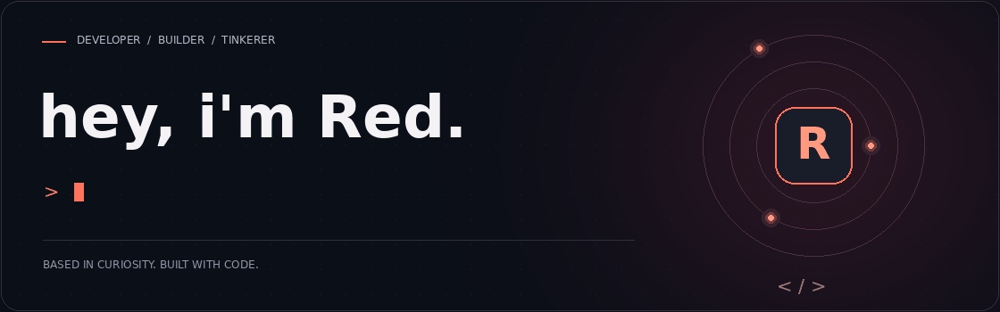
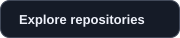
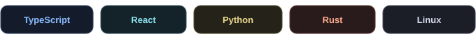

 

**Curiosity first. Code follows.**

I turn ideas into apps, automate the repetitive stuff, 
and enjoy figuring out how things work underneath.

 

&nbsp;&nbsp;

  

 

### Things I gravitate toward

**AI & automation** &nbsp; / &nbsp; **Web & mobile** &nbsp; / &nbsp; **Developer tools**

Small experiments. Useful software. A good reason to learn something new.

 

  

<b>Behind the keyboard</b>

 

Call me **Red** — Reydian if we're being formal.

I'm interested in the whole path from an idea to something people can use: 
the interface, the logic, and the systems keeping it running.

Always learning. Usually building something.

 

 

Breaking things professionally. Fixing them personally.

