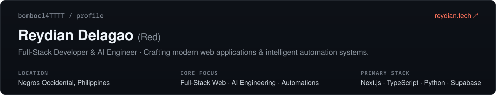

 

  
  
  
  

---

### Stack &amp; Tools

  
  
  
  
  
  
  
  
  
   
  
  
  
  
  
  
   
  
  
  
  
   
  
  
  
  
  
  

---

### What I Do

- **Full-Stack Development** — Architecting modern web applications with Next.js, React, and TypeScript, styled with Tailwind CSS and enhanced with Framer Motion and Three.js.
- **Backend &amp; Databases** — Designing performant REST APIs, managing relational and document databases across PostgreSQL, MongoDB, and Supabase with strict security rules.
- **AI Engineering &amp; Automation** — Building intelligent automation pipelines using n8n and Zapier, local LLM integrations with Ollama, and autonomous multi-agent workflows.
- **Cloud, DevOps &amp; UI Design** — Containerizing services with Docker, deploying across Vercel and Cloudflare, with design systems prototyped in Figma.

---

### Connect

Feel free to reach out for collaborations, discussions on AI automations, or just to chat about tech:

- **Portfolio:** [reydian.tech](https://www.reydian.tech)
- **LinkedIn:** [reydian-delagao](https://www.linkedin.com/in/reydian-delagao-092723410)
- **Email:** [reydian04@gmail.com](mailto:reydian04@gmail.com)
- **GitHub:** [@bombocl4TTTT](https://github.com/bombocl4TTTT)

---

  Reydian A. Delagao &nbsp;•&nbsp; <a href="https://www.reydian.tech">reydian.tech</a>

