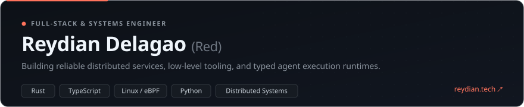

 

**Reydian Delagao** (Red) · Systems & Full-Stack Engineer based in Bacolod, Philippines.  
Building reliable web platforms, low-level tooling, and typed agent execution runtimes.

[Website](https://www.reydian.tech) &nbsp;•&nbsp; [Kasya-Pa (Live)](https://kasya-pa.vercel.app) &nbsp;•&nbsp; [Projects](https://github.com/bombocl4TTTT?tab=repositories) &nbsp;•&nbsp; [Email](mailto:reydian04@gmail.com)

---

### What I'm Building

I'm drawn to software that remains reliable when things get chaotic—from tracing kernel sockets in Linux and enforcing idempotency in financial ledgers, to establishing deterministic boundaries for AI workflows.

- **[Kasya-Pa](https://kasya-pa.vercel.app)** — Community-first public transit route finder and interactive map for Bacolod City commuters. [Live App ↗](https://kasya-pa.vercel.app)
- **[RedX](https://github.com/bombocl4TTTT/redx)** — Experimental programming language for typed agent workflows written in Rust. Features a custom lexer, parser, type checker, intermediate representation, and virtual machine to make side-effects, tools, and approval checkpoints explicit.
- **[bwtrack](https://github.com/bombocl4TTTT/bwtrack)** — Linux per-application network bandwidth recorder powered by eBPF kernel probes, SQLite historical persistence, and a terminal UI (Ratatui).
- **Backend Architecture Demos** — Focused implementations of distributed systems patterns:
  - **Hookbase**: High-reliability webhook dispatcher with exponential backoff, cryptographic signatures, and dead-letter queues.
  - **Ledgerly**: Double-entry bookkeeping engine exploring concurrency control, balance locks, and idempotent transaction mutations.
  - **CompanySearch**: Hybrid knowledge retrieval engine evaluating lexical BM25 token matching alongside dense vector similarity.
  - **Workspaces**: Multi-tenant RBAC permissions, invitation lifecycle, seat limits, and audit trails.

---

### Technical Focus

| Domain | Core Technologies & Patterns |
| :--- | :--- |
| **Languages** | Rust, TypeScript, JavaScript, Python, Go, SQL, Bash |
| **Systems & Kernel** | Linux, eBPF (Aya), SQLite, Terminal UIs (Ratatui), Concurrency |
| **Backend & Reliability** | Node.js, Next.js, PostgreSQL, Redis, Idempotency, Webhook Pipelines, Event Queues |
| **Frontend & GIS** | React, Next.js, Tailwind CSS, MapLibre GL, Leaflet, Responsive UI |
| **AI & Workflow Runtimes** | Deterministic agent boundaries, Multi-agent orchestration, Tool evaluation |

---

### Engineering Principles

- **Observability Over Guesswork** — Systems should expose their internal state clearly, whether via eBPF kernel probes or structured audit trails.
- **Explicit Failure Boundaries** — In agentic systems, side effects, tool invocations, and approvals belong in typed, verifiable contracts rather than implicit prompt logic.
- **Solving Concrete Problems** — From local public transit routing to dependable webhook dispatching, code should deliver tangible utility.

---

  Reydian A. Delagao &nbsp;•&nbsp; <a href="https://www.reydian.tech">reydian.tech</a> &nbsp;•&nbsp; <a href="mailto:reydian04@gmail.com">reydian04@gmail.com</a>

